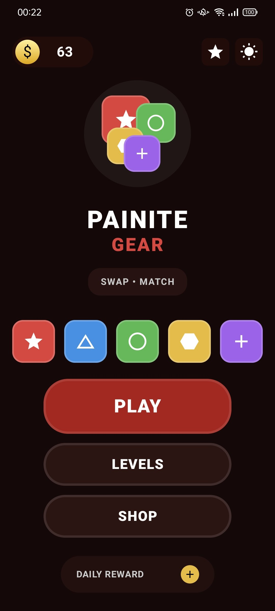
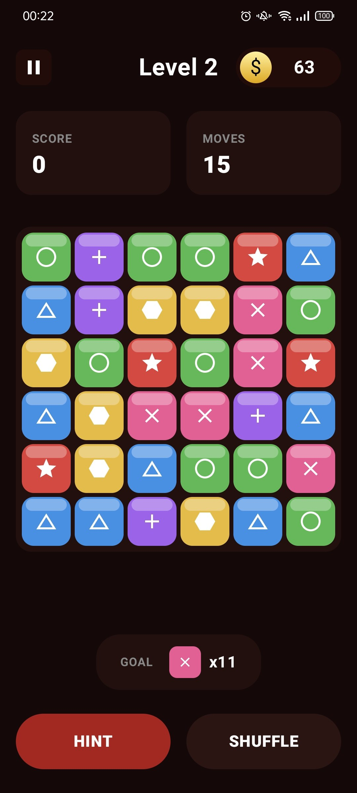
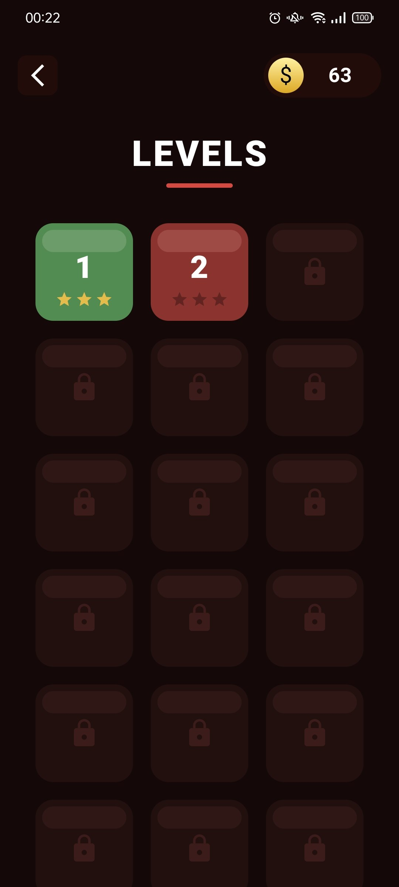
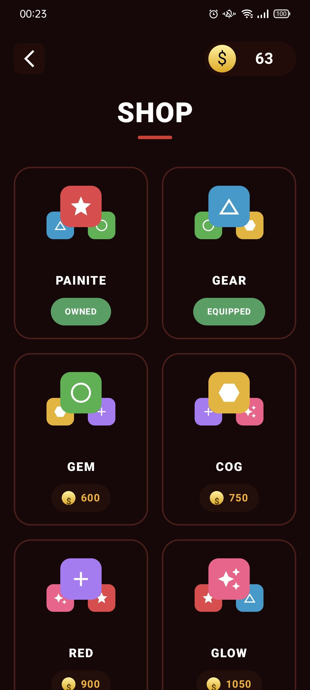
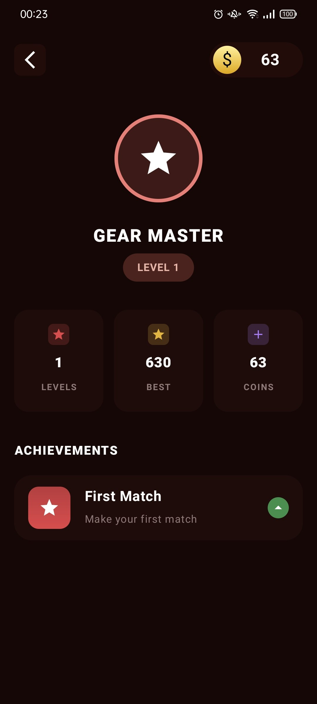
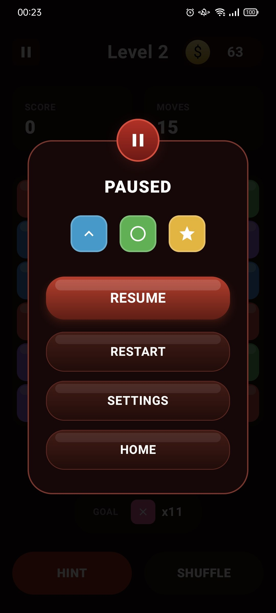
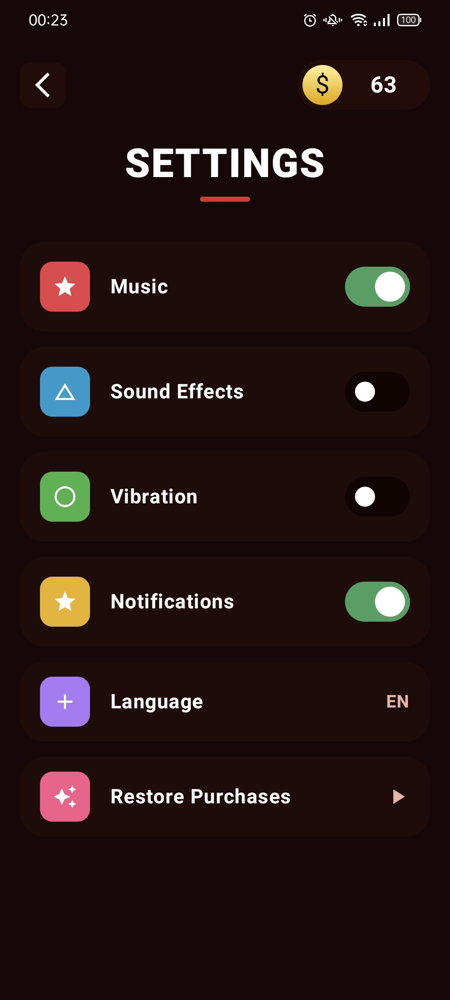

# 🧩 Gear Master: Match-3 Puzzle

Сучасна, стильна та динамічна мобільна гра жанру "3 в ряд", повністю написана на **Kotlin** з використанням найновіших інструментів Android-розробки. Проєкт поєднує в собі плавні анімації, продуманий UI/UX та надійну архітектуру.

---

## 📸 Скриншоти гри

### 🎮 Ігровий процес та Головне меню
Динамічне ігрове поле з плавною генерацією кубиків, підрахунком ходів та системою підказок.

<p float="left">
  
   
</p>

### 🗺️ Прогрес та Кастомізація
Гравці можуть проходити рівні, заробляти монети та розблоковувати нові візуальні теми для кубиків.

<p float="left">
  
   
</p>

### 🏆 Профіль та Досягнення
Детальна статистика, система досягнень та відстеження найкращих результатів гравця.

<p float="left">
  
</p>

### ⚙️ Інтерфейс та Налаштування
Зручне меню паузи та повний контроль над звуком, вібрацією та мовою.

<p float="left">
  
   
</p>

---

## 🚀 Основні фічі

* **Власний Match-3 рушій:** Логіка пошуку збігів, падіння блоків, генерації нових елементів та підрахунку комбо реалізована з нуля.
* **100% Jetpack Compose:** Весь UI побудований на декларативному підході з використанням кастомних модифікаторів, складних градієнтів та ефектів світіння.
* **Локальне збереження прогресу:** Гроші, пройдений прогрес, куплені теми та досягнення надійно зберігаються на пристрої.
* **Анімації:** Використання `AnimatedVisibility`, `animateDpAsState` та `spring` для плавного переміщення та знищення блоків.

## 🛠 Технологічний стек

* **Мова:** Kotlin
* **UI:** Jetpack Compose
* **Архітектура:** MVVM + Unidirectional Data Flow
* **Dependency Injection:** Dagger Hilt
* **Локальне збереження:** Preferences DataStore
* **Асинхронність:** Kotlin Coroutines & StateFlow
* **Навігація:** Jetpack Navigation Compose

## 🏗 Архітектура та DI

Додаток використовує **Dagger Hilt** для впровадження залежностей. `GameRepository` виступає єдиним джерелом правди для збереження даних гравця через **DataStore**. Ці дані реактивно передаються у ViewModels за допомогою `StateFlow`, що забезпечує миттєве оновлення UI без додаткових запитів.

## 📦 Як запустити локально

1. Клонуй репозиторій:
   ```bash
   git clone https://github.com/vlad595/Test-Task_3-in-a-row_Game.git
   ```
2. Відкрий проєкт у Android Studio (рекомендується версія Iguana або новіша).
3. Дочекайся завершення синхронізації Gradle.
4. Натисни Run для запуску на емуляторі або реальному пристрої.